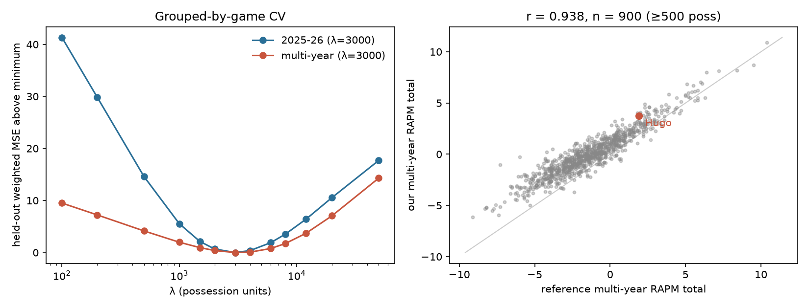

# Test 0: baseline RAPM replication

**Decision:** PASS

| Fit | Window | λ (CV) | Stints | Possessions | Players | Intercept |
|---|---|---|---|---|---|---|
| 1-year | 2025-26 | 3000 | 67,241 | 244,553 | 582 | 116.23 |
| multi-year | 2020-21 → 2025-26 | 3000 | 368,937 | 1,430,417 | 1095 | 114.65 |

Garbage time excluded: False. Ranks are among players with ≥500 on-court possessions in the window.

## Hugo Gonzalez

| Source | Off | Def | Total | Rank | Possessions |
|---|---|---|---|---|---|
| Ours, 1-year 2025-26 | +1.65 | +1.76 | +3.41 | 25 | 4,238 |
| nbarapm 1Y (plan) | +2.00 | +1.60 | +3.60 | 23 |  |
| Ours, multi-year 2020-21 → 2025-26 | +1.98 | +1.75 | +3.73 | 56 | 4,238 |
| Reference (Multi-year RAPM 2020-21 to 2026-27 (user-supplied spreadsheet)) | +0.20 | +1.70 | +1.90 | 96 | 4,450 |

## League-wide comparison with the reference

Players with ≥500 possessions in our multi-year window: 900.

| | Off | Def | Total |
|---|---|---|---|
| Correlation, our multi-year vs reference | 0.911 | 0.930 | 0.938 |
| Possession-weighted mean, ours | +0.54 | +0.52 | +1.07 |
| Possession-weighted mean, reference | +0.03 | -0.00 | +0.03 |

For context, our **1-year** fit correlates 0.719 with the multi-year reference. That gap is the cost of the window mismatch, not a parsing error.

## Diagnostic: Hugo vs the reference, relative to similar-sample players

Our multi-year total for Hugo is +1.83 above the reference. The reference centers players differently: its possession-weighted mean is about 0 and low-possession players sit well below it, while ridge toward 0 leaves our weighted mean positive. So compare Hugo's gap with the average gap for the 91 players whose on-court possessions are within ±30% of his (2,966–5,509).

| Ours − reference | Off | Def | Total |
|---|---|---|---|
| Hugo | +1.78 | +0.05 | +1.83 |
| Similar-sample cohort, mean | +1.18 | +0.55 | +1.73 |
| Hugo relative to cohort | +0.60 | -0.50 | +0.10 |

## Top 15, our multi-year fit

| name                    | team   |   poss_on |   off |   def |   total |
|:------------------------|:-------|----------:|------:|------:|--------:|
| Nikola Jokić            | DEN    |     61060 | +8.56 | +2.34 |  +10.90 |
| Kawhi Leonard           | LAC    |     36568 | +6.47 | +2.25 |   +8.72 |
| Giannis Antetokounmpo   | MIL    |     50619 | +5.30 | +2.89 |   +8.19 |
| Shai Gilgeous-Alexander | OKC    |     54207 | +6.22 | +1.90 |   +8.12 |
| Victor Wembanyama       | SAS    |     22837 | +1.43 | +6.54 |   +7.97 |
| Chet Holmgren           | OKC    |     22000 | +3.47 | +3.57 |   +7.04 |
| Joel Embiid             | PHI    |     37522 | +3.47 | +3.42 |   +6.89 |
| Rudy Gobert             | MIN    |     55963 | -0.18 | +7.02 |   +6.83 |
| Derrick White           | BOS    |     53009 | +2.32 | +4.40 |   +6.72 |
| Kyrie Irving            | DAL    |     37095 | +5.81 | +0.43 |   +6.24 |
| Alex Caruso             | OKC    |     32610 | +0.12 | +6.00 |   +6.12 |
| Franz Wagner            | ORL    |     42544 | +2.52 | +3.56 |   +6.09 |
| Kevin Durant            | HOU    |     52123 | +4.29 | +1.68 |   +5.97 |
| Donovan Mitchell        | CLE    |     53040 | +5.08 | +0.74 |   +5.82 |
| Herbert Jones           | NOP    |     36003 | +1.69 | +4.09 |   +5.78 |

