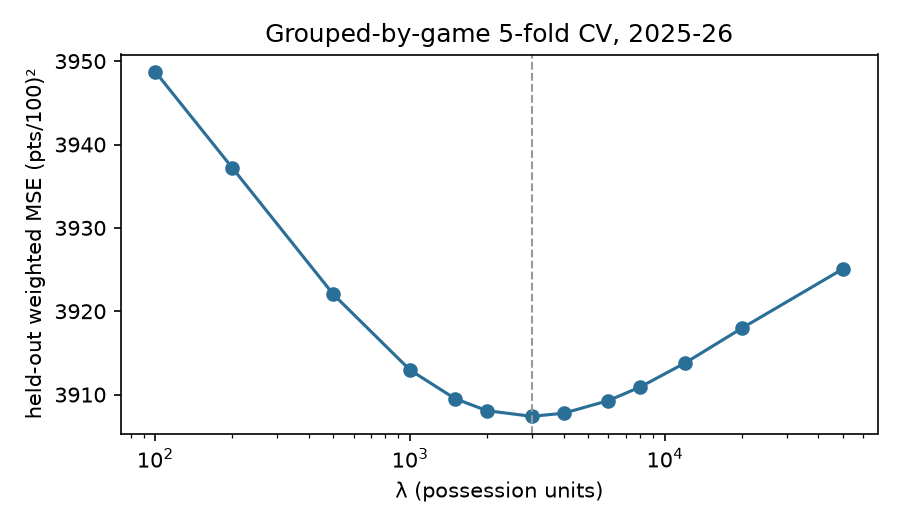

# Test 0: baseline RAPM replication (2025-26)

**Decision:** PARTIAL: Hugo within 1.5 of published; league-wide correlation pending a published snapshot in data/external/

- Stints: 67,241; possessions: 244,553; players: 582
- League intercept: 116.23 pts/100; CV-optimal λ = 3000
- Garbage time excluded: False

## Hugo Gonzalez

| | Off | Def | Total | Rank (≥500 poss, n=494) | Rank (all) |
|---|---|---|---|---|---|
| Ours | +1.65 | +1.76 | +3.41 | 25 | 25 |
| nbarapm 1Y (plan) | +2.0 | +1.6 | +3.6 | 23 | |

On-court possessions: 4,238. Gap to published total: -0.19.

## League-wide comparison

No published snapshot in `data/external/nbarapm_rapm_*.csv`; correlation not computed. See README for the expected export format.

## Top 15 (≥500 possessions)

| name                    | team   |   poss_on |   off |   def |   total |
|:------------------------|:-------|----------:|------:|------:|--------:|
| Victor Wembanyama       | SAS    |      7727 | +2.10 | +4.42 |   +6.52 |
| Shai Gilgeous-Alexander | OKC    |      9408 | +4.24 | +2.12 |   +6.35 |
| Kawhi Leonard           | LAC    |      8324 | +4.04 | +2.05 |   +6.09 |
| Chet Holmgren           | OKC    |      8228 | +1.60 | +4.47 |   +6.07 |
| Nikola Jokić            | DEN    |      9517 | +4.58 | +0.63 |   +5.20 |
| Derrick White           | BOS    |     10306 | +1.47 | +3.65 |   +5.12 |
| Dyson Daniels           | ATL    |     10611 | +2.48 | +2.37 |   +4.85 |
| Bam Adebayo             | MIA    |     10010 | +2.38 | +2.23 |   +4.61 |
| Marcus Smart            | LAL    |      7212 | +1.49 | +3.12 |   +4.61 |
| Neemias Queta           | BOS    |      7479 | +1.27 | +3.32 |   +4.59 |
| Jimmy Butler III        | GSW    |      4873 | +2.53 | +1.92 |   +4.45 |
| Moussa Diabaté          | CHA    |      7528 | +3.35 | +0.99 |   +4.34 |
| Julian Champagnie       | SAS    |      9423 | +2.82 | +1.50 |   +4.32 |
| Ausar Thompson          | DET    |      7764 | +1.56 | +2.69 |   +4.25 |
| Cade Cunningham         | DET    |      8959 | +2.95 | +1.24 |   +4.19 |

